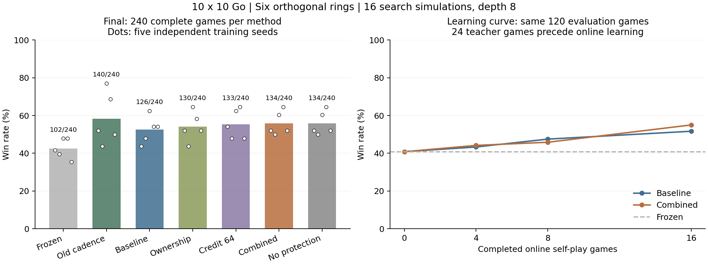

# Go12：有限反馈、终局归属与长信用的实测结果

实验开始于 2026-10-20，2026-10-21 完成。保留正交六环、当前参数下的约束传播和先预测后更新协议。

**结论：小模型在已有围棋先验下能够通过在线反馈改善棋力；本轮新增组合尚未建立超过旧方案的优势。归属预测确实学到了东西，但历史判断和按位置读取环内容仍未形成有效的决策能力。因此保留旧默认更新节奏，新功能作为可开关的实验机制。**

## 实现与验证

本轮实际修改四个核心文件：

- `mqr/go.py`：新增逐点面积归属，与原面积计分一致；独立洪水填充复核全部棋谱的得分。
- `mqr/agent.py`：可选归属输出、归属损失、轨迹反馈和待反馈检查点支持，旧字段及默认权重兼容。
- `mqr/go_policy.py`：新增 21 参数的归属头，读取空间特征及按位置查询的环内容。总模型 36,212 参数，在线方案可训练参数 30,607。
- `mqr/go_outcome.py`：真实终局验证之后生成执色一致的归属标签；将终局回放窗口与信用截断长度分开配置。

新增功能的默认值关闭。没有更改正交状态递推、现有约束投影或原在线学习接口的默认行为。旧 Go11 检查点成功加载，原探针输出逐值一致。

全部 **180 项根测试**通过，包括归属颜色/中立区、禁止提前终局标签、共享环梯度、零权重控制、匹配更新数、待反馈恢复，以及归属读出的解析伴随与完整自动微分对拍。数学校验、快速示例、语法检查通过；Digits 回归的非计时统计与 Go11 完全一致。

详细数学条件见 [数学合同](go12_math.md)。它证明传播、读出和投影的局部性质，不证明棋力必然提高。归属辅助监督有 [KataGo §4.1](https://arxiv.org/html/1902.10565v5#S4.SS1) 等先例，本轮不将其本身视为理论创新。

## 完整实验口径

- 正式独立种子：811、821、823、827、829；开发种子 3901 排除。
- 10×10，贴目 5.5，情境超级劫、禁自杀、连续双停着、面积计分。保留现有无死子裁定的环境限制。
- 每种子公共先验来自 **24 局教师/随机棋局、24 epoch**；预训练不使用教师胜负来训练值头。随后每在线方法学习 **16 局完整自博弈**，双方共用同一个在线学生。
- 六环、16 维环状态、两层 12 通道空间卷积、8 维查询；空间卷积特征冻结。没有外部记忆槽。
- 所有训练和评估均使用 **每步 16 次搜索模拟、深度 8**。实际棋谱长度和节点调用数会随策略变化，不是严格等 FLOPs。
- 每主方案 240 局冻结评估，配对开局交换颜色，包含 4/24/60 手开局及两种本地启发式对手；baseline/combined 在第 4、8 局额外各评估 120 局。
- 原六组的终局回放窗口统一 64；短信用每 16 步 detach，长信用每 64 步 detach。在线窗口始终 16。相同轨迹上的更新次数匹配。
- 在完整矩阵尚未生成时，因发现旧实现的回放更新频率不同，追加 `legacy` 对照：终局窗口/信用均为 16，其他先验、训练局数、评估与搜索预算相同。该补充见 [旧节奏对照说明](go12_legacy_control.md)，不混称为原先的等更新次数消融。

最终完成 **2,160 局冻结评估 + 480 局在线训练 + 140 局公共先验/探针来源 = 2,780 局完整棋谱**。全部独立重放，核对合法性、真实终局、计分和标签数量；从恢复的检查点复现 70 盘抽样比赛的 **4,002 次搜索落子**。没有将截断局面判为比赛结果。

当前预算与 Go11 的 32/64 模拟、深度 16 不同，禁止把两轮胜率直接解释为算法前后变化。这里的“少量学习”是已有先验下的在线适应，不是从零用 16 局学会围棋。

## 最终棋力

每列种子胜局均来自 48 局，顺序为 811/821/823/827/829。

| 方法 | 终局窗口 / 信用 | 归属监督 | 胜局 / 240 | 胜率 | 逐种子胜局 | 平均目差 |
|---|---:|---|---:|---:|---|---:|
| 冻结模型 | 不更新 | 无 | 102 | 42.50% | 20 / 19 / 23 / 23 / 17 | −46.10 |
| 旧更新节奏 `legacy`（追加） | 16 / 16 | 无 | **140** | **58.33%** | 25 / 21 / 37 / 33 / 24 | −24.39 |
| 匹配对照 `baseline` | 64 / 16 | 无 | 126 | 52.50% | 21 / 23 / 30 / 26 / 26 | −28.60 |
| 归属 `ownership` | 64 / 16 | 有 | 130 | 54.17% | 25 / 21 / 31 / 28 / 25 | −29.70 |
| 长信用 `credit` | 64 / 64 | 无 | 133 | 55.42% | 26 / 23 / 30 / 31 / 23 | −28.97 |
| 组合 `combined` | 64 / 64 | 有 | 134 | 55.83% | 25 / 24 / 29 / 31 / 25 | −29.83 |
| 组合、移除保护 `unprotected` | 64 / 64 | 有 | 134 | 55.83% | 25 / 24 / 29 / 31 / 25 | −29.83 |

主要配对差值以训练种子为独立单位，给出五种子全部 3,125 种重采样的描述性 95% bootstrap 区间，单位为百分点：

| 比较 | 均值差 | 描述性区间 |
|---|---:|---:|
| 旧节奏 − 冻结 | +15.83 | [8.75, 23.75] |
| 匹配对照 − 冻结 | +10.00 | [5.00, 15.42] |
| 归属 − 匹配对照 | +1.67 | [−2.08, 5.42] |
| 长信用 − 匹配对照 | +2.92 | [−2.50, 8.33] |
| 组合 − 匹配对照 | +3.33 | [−1.25, 7.92] |
| 组合 − 旧节奏 | −2.50 | [−10.00, 3.33] |
| 组合 − 冻结 | +13.33 | [10.83, 15.83] |

在线更新的本地收益在五个种子中均出现。但新增归属、长信用及组合的额外优势均未得到清晰支持；也不能从 −2.50 的点估计断言新组合必然劣于旧节奏。五个训练种子不足以作强泛化结论。

组合方案仍有 **85/240** 局至少输 50 目，黑方 54/120 胜、白方 80/120 胜。平均目差为负，说明胜率改善没有消除严重败局。对手是本地启发式程序，这不是棋力评级或强引擎基准。



图中旧节奏为追加对照；其余六组来自原固定矩阵。散点是五个训练种子，不是独立训练了 240 个模型。

## 少量反馈是否有效

以下统一使用同一批 **120 局**评估开局，16 局终点取最终 240 局中的预定前半部分，因此不应与上表的 240 局分母混用。

| 已完成在线自博弈 | 匹配对照 | 组合 |
|---:|---:|---:|
| 0 | 49/120，40.83% | 49/120，40.83% |
| 4 | 52/120，43.33% | 53/120，44.17% |
| 8 | 57/120，47.50% | 55/120，45.83% |
| 16 | 62/120，51.67% | 66/120，55.00% |

这支持“有限在线经验可以改善已有策略”，尚不支持“四局就获得成熟判断能力”。4 局和 8 局时的增益较小，组合在 8 局点还低于匹配对照。

更新预算也很关键：

| 方法 | 在线观察总数 | 搜索网络调用 | 尝试 / 接受更新 |
|---|---:|---:|---:|
| 旧节奏 | 8,749 | 134,508 | 1,172 / 1,172 |
| 匹配对照 | 8,333 | 128,035 | 736 / 736 |
| 组合 | 8,182 | 125,510 | 721 / 721 |

64 步终局窗口减少了优化次数。原六组正确隔离了信用截断，但不能拿它们直接替代旧节奏而忽略这个代价。旧节奏成绩较好的具体原因还可能包括更新顺序和随策略变化的训练轨迹，不能只归因于次数。

## 判断能力和历史读出的诊断

下列补充是只读机制诊断，不参与调参。其中归属分解是在看到首个种子“归属误差下降、查询不改变落子”后追加的事后分析。

### 1. 归属预测学到了，但不足以代表局势判断

在共同的 120 个完整历史教师探针上，组合的归属 MSE 从匹配对照的 **0.98079 降到 0.65701，降低 33.01%**。这是真实的辅助预测改进。

但只复制当前棋子的归属、把空点设为中立的输入基线，MSE 已有 **0.59608**，优于新归属头。组合在已有棋子上的误差为 **0.50779**，在空点上的误差为 **0.80919**，未来空点归属仍难以判断。

直接把预测归属求和并扣除贴目，胜负符号准确率为 **70%**，没有超过这批教师棋局中“总预测白方获胜”的 **70%**先验。两者的具体预测并非完全相同。原值头在这些迁移探针上的符号准确率为 **62.5%**。这些是教师行为结果，不能冒充当前自博弈策略的真值。

更贴近实际训练的预反馈终局价值 MSE 为 **0.98647**，零预测基线为 1；当前值头的信号仍较弱。此外，新归属输出没有直接进入搜索价值，只有通过共享特征间接影响策略。这解释了为什么辅助误差改善不自动转换成棋力收益。

### 2. 按位置读取环内容仍几乎不影响落子

组合方案的查询修正 RMS 均值为 **0.003585**，空间分支为 **5.90346**，两均值之比约 **0.061%**。在 120 个完整历史探针中：

- 屏蔽按位置查询修正：**0/120** 个贪心动作改变。
- 每次只从当前观察重建状态：**4/120** 个动作改变。

这表明历史可以经全局调制等路径产生一些影响，但按位置查询分支尚未形成足够的决策作用。这里不是完整比赛的去环消融，也不能据此断言所有环路径无效。

### 3. 两步历史就足够的劫任务仍未学会

另外构造每种子 100 对、共 **500 对/1,000 个位置**的合法摆子起始历史。每对最终编码完全相同，回提在一支历史中合法、另一支中违反超级劫。它们不是从空棋盘开始的完整比赛，不计入 2,780 局。

所有六个主方法的原始合法性头准确率都是 **50%**，同时正确区分两支历史的对数为 **0/500**。组合的两支环状态仍有平均 L2 差异 **0.05627**，但合法性输出没有有效使用它。当前观察单独重放时，两支输出严格一致，确认任务确实需要历史。

这种任务只需两次观察，因此不能把失败主要解释成“16 步信用不够长”。训练覆盖存在直接缺口：公共预训练的 12,364 个位置只观察到 **2 次直接单子劫禁止**；组合在线训练的 8,182 个位置只观察到 **13 次**。合法性损失又在 100 个棋盘点上平均，稀有历史规则的反馈很容易被普通占点合法性淹没。这里只统计直接单子劫，不包括所有长循环超级劫。

这不是证明网络无法表示劫规则，而是说明当前经验分布和读出训练没有教会它。比赛中规则掩码保证执行动作合法，也掩盖了这个模型能力缺口。

### 4. 保护模块正确运行，但当前对局没有真正考验它

组合方案 **721/721** 次更新通过，活跃约束更新 **0 次**，缩步 **0 次**，投影范数保留率均为 1。20 个共同参考锚点没有 margin 违规；无保护组合也没有违规，且两个方案最终胜局完全相同。

因此本轮不能宣称“OGD/任务约束提高了棋力或避免了遗忘”。它验证了实现与数值合同，但四个初始短历史锚点的约束在这批更新中没有成为实际限制。保护范围也只是原始策略动作 margin，不是所有历史、全部新增知识或所有 MCTS 搜索决策。

## 对当前架构的判断与下一步

没有发现使本轮结果失效的梯度、终局标签或恢复错误；根测试、独立棋谱和搜索复现均通过。问题主要集中在 **经验覆盖、记忆读出与行动目标之间的连接**，尚不能凭这些结果宣布整个正交环架构无效，也不能宣称正交几何具有独特棋力优势。

建议按下面的顺序继续，新增假设应另用独立确认数据，不能沿用本轮正式结果反复调参：

1. **保留有效更新频率。** 以旧 16 步回放为参照，再检验归属监督；长信用应尝试“64 步上下文、每 16 步更新、只给新 16 步计算损失”的方案，明确处理当前参数重放和历史状态，避免把延长信用变成减少优化次数。
2. **让任务明确要求读出历史。** 对真实劫、禁入点及局部对杀建立平衡、可验证的困难样本。在固定搜索预算内利用已访问的反事实状态，单独考核不依赖规则掩码的原始预测，并报告额外规则查询和数据量。
3. **把学到的预测接回动作评估。** 归属/局部结果先超过当前棋子与执色先验，再测试其对候选动作比较、搜索和值目标的贡献；不能直接把目前较弱的归属和当作可靠价值。
4. **保护可验证的新能力。** 增加能实际激活约束的任务切换和历史锚点，检查已学行为漂移。之后再比较同参数量的几何/记忆对照，判断收益是否来自正交环，而不是通用回放、先验或搜索。

本轮实现了可测试的在线适应闭环，但不是 TTT-Discover 的复现，也没有实现 RSI。前者的原始研究针对已有强先验模型在当前问题上的测试时学习，[主配置为 50 次更新、每次 512 个 rollout](https://arxiv.org/html/2601.16175v2#S3.SS3)。本项目还需要证明学到的能力能够被决策读出、跨局保留并迁移到未见任务。

## 复现、原始证据和保护

```bash
python3 test_go_efficiency.py
python3 analysis/go12_run.py --workers 8
python3 analysis/go12_verify.py --workers 2
# 追加旧节奏对照，须已有共同的 go12_v1 预训练底座：
for seed in 811 821 823 827 829; do
    python3 experiments/go12_legacy_control.py --seed "$seed"
done
python3 analysis/go12_legacy_verify.py
python3 analysis/go12_history_diagnostic.py
python3 analysis/go12_ownership_diagnostic.py
python3 analysis/go12_review.py
python3 analysis/go12_plot.py
```

完整矩阵命令写入默认检查点和结果路径。重新研究时使用独立工作副本；单方案可通过 `--directory`、`--output` 指定独立目录。`--max-plies` 保存并暂停未完棋局，不制造终局。检查点留在本地，不作为源码提交。

- [原始固定协议](go12_plan.md)、[追加对照说明](go12_legacy_control.md)
- [主结果及独立核验](results/go12_summary.json)、[旧节奏结果及核验](results/go12_legacy_summary.json)
- [历史诊断](results/go12_history_diagnostic.json)、[归属分解诊断](results/go12_ownership_diagnostic.json)、[训练暴露与约束活动](results/go12_review.json)
- [测试日志](results/go12_checks.json)、[Digits 回归](results/go12_digits_regression.json)、[旧检查点兼容性](results/go12_legacy_compatibility.json)
- [实现/协议哈希与开发记录](results/go12_source.json)、[主矩阵执行记录](results/go12_execution.json)、[追加对照执行记录](results/go12_legacy_execution.json)
- [最终文件、测试计数与实验总数核对](results/go12_final_checks.json)
- [CodeRecoder 修改前后保护回执及文件覆盖校验](results/go12_protection.json)

运行使用 Python/PyTorch CPU 单线程子进程，并发完成。计时包含当时的资源竞争，不作为隔离硬件基准；报告的在线张量字节数不包括完整 Python 进程和自动微分峰值内存。
