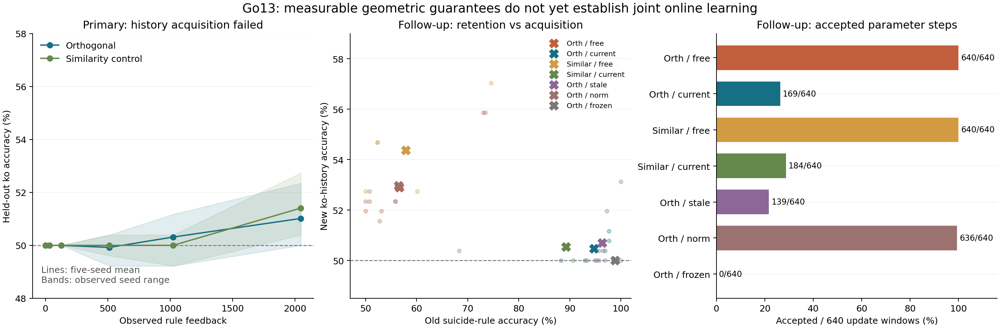

# Go13：整体算法研究结果

本轮把目标固定为“小模型能否利用历史学会新判断，并在当前参数行为约束下保持旧能力”。围棋是可验证环境，胜率是外部集成指标。结论是：**正交传播的几何性质成立，行为保护确实限制了漂移；当前组合仍未建立可靠历史学习与旧能力保持的联合优势。**

已经完成五种子、七方法的原矩阵及一次明确标记的任务顺序补充，共 **1,820 局完整 10×10 棋谱**。两轮各有每方法 120 局评估；此外有 140 局共同先验与探针来源。没有把设置局面、历史片段、独立重放或重复搜索计入完整对局数。

## 研究实现与可复查材料

- [固定协议](go13_plan.md)、[补充协议](go13_transfer_plan.md)、[数学推导](go13_math.md)。补充是在原矩阵的历史学习失败后追加，不能替换原结果。
- [原结果](results/go13_summary.json)、[补充结果](results/go13_transfer_summary.json)、[证据索引](results/go13_findings.json)。全部学习窗口记录反馈前预测；检查点保留在本地，不随 Git 提交。
- 新增 `mqr/go_research.py`：当前参数行为法向量、实际 Adam 增量投影、有限步行为检查、可恢复的在线反馈窗口，以及稳定相似变换控制。既有线上会话的默认行为未改动。
- 共同模型 36,191 个参数，32,577 个可训练参数，六个 16 维正交环；输入条件化旋转与按位置查询保留。原始外部历史槽为零，本轮不检验外部记忆收益。
- 正交控制为原模型；非欧氏正交控制为固定条件数 2 的 `S R(x) S^-1`。参数数目、初始化、写入和读出形式相同，传播不会额外指数衰减。它是坐标条件化控制，不能代表一般非正交网络。



图中阴影是五个种子的实际范围；补充散点为各个种子，叉号为均值。离线探针不混入在线成绩。

## 1. 原矩阵：历史能力没有先学会，保护前提失败

共同空间先验使用每种子 24 局完整教师／随机棋局、24 epoch。随后学习 A：2,048 条平衡劫历史反馈；再学习 B：1,024 条平衡自杀／可落子反馈。每 16 条反馈一次更新，A/B 分别为 128/64 次尝试。A→B 同时携带参数和完整 Adam 动量。

A 的每对最终观察完全相同，标签相反，必须使用前一观察才能区分；B 的局部规则从当前棋盘可判断。两者都由真实围棋引擎验证，没有反转规则制造冲突。它们是合法设置局面中的两次观察问题，并非从空棋盘开始的完整对局。

| 方法 | A 学完后的劫准确率 | 再学 B 后的劫准确率 | B 自杀判断 | 共同历史保护锚点（五种子总计） | 完整比赛胜局 |
|---|---:|---:|---:|---:|---:|
| 正交／无保护 | 51.02% | 50.00% | 58.75% → 98.83% | 0 | 18/120 |
| 正交／当前约束 | 51.02% | 50.00% | 58.75% → 98.83% | 0 | 18/120 |
| 相似变换／无保护 | 51.41% | 50.00% | 58.67% → 99.06% | 0 | 20/120 |
| 相似变换／当前约束 | 51.41% | 50.00% | 58.67% → 99.06% | 0 | 20/120 |
| 正交／8 步刷新 | 51.02% | 50.00% | 58.75% → 98.83% | 0 | 18/120 |
| 正交／步长对照 | 51.02% | 50.00% | 58.75% → 98.83% | 0 | 18/120 |
| 正交／冻结 | 51.02% | 51.02% | 58.75% → 58.75% | 0 | 56/120 |

五个种子都没有同时被两种几何正确掌握、且 margin > .02 的完整历史样本对。保护集合为空，当前约束、过期刷新、无保护与步长对照在同一几何下得到相同更新。**这表示保护未被检验，不能称为“保护零违规”或“有无保护等价”。**

本轮明确提供 2,048 条平衡历史反馈，补上了上一轮“几乎不见劫样本”的设计缺口，但历史学习仍只有约 51%；尚不能排除当前架构需要更多反馈。B 则达到约 99%，说明反馈与更新接口能够学习局部规则；问题集中在历史表征、查询及其优化，而不是所有学习通路都失效。

## 2. 补充：保护已掌握的能力，再尝试学习新历史

补充从原 `orth_free`／`similar_free` 学完 B 的参数和 Adam 状态开始。旧任务是已掌握的自杀判断；每种子选取共同正确的 16 条旧训练样本作保护，保持其原正确 margin 的 50%。新任务是与原训练和测试都无重叠的 2,048 条劫历史反馈。仍每 16 条更新一次，共 128 次尝试。五种子仍是原来的五种子，不能算额外五个独立种子。

| 方法 | 旧任务留出准确率 | 新历史留出准确率 | 最终违反下界的训练锚点 | 接受的参数更新 | 补充比赛胜局 |
|---|---:|---:|---:|---:|---:|
| 正交／无保护 | 98.83% → 56.64% | 52.89% | 66/80 | 640/640 | 28/120 |
| 正交／当前约束 | 98.83% → 94.69% | 50.47% | 0/80 | 169/640 | 39/120 |
| 相似变换／无保护 | 99.06% → 57.89% | 54.38% | 74/80 | 640/640 | 35/120 |
| 相似变换／当前约束 | 99.06% → 89.22% | 50.55% | 0/80 | 184/640 | 29/120 |
| 正交／8 步刷新 | 98.83% → 96.33% | 50.70% | 0/80 | 139/640 | 37/120 |
| 正交／步长对照 | 98.83% → 56.48% | 52.97% | 66/80 | 636/640 | 32/120 |
| 正交／冻结 | 98.83% → 98.83% | 50.00% | 0/80 | 0/640 | 30/120 |

此表冻结组冻结于已经学会 B 的时刻；原表冻结组冻结于 A 之后，因此两个冻结行不是同一检查点。两轮使用不同配对开局，不能合并胜率作同一模型的评估。

当前正交保护把旧任务准确率保在 94.69%，相比无保护的 56.64% 有明显保持收益。但新历史只有 50.47%，未形成可靠判断。新历史五种子平均损失从 3.730 降至 1.109；损失降低可能只是纠正过度自信，不能代替正确判断。

受保护的 80 条训练锚点均满足下界，但未保存的旧任务仍从 98.83% 降到 94.69%。**有限锚点保护不等于分布上的不遗忘。** 相似变换控制也能保护锚点，因此不能把所有保护效果归于正交独有性质。

| 配对差值，单位百分点 | 旧任务准确率变化之差：均值 [95% 区间] | 新任务准确率变化之差：均值 [95% 区间] |
|---|---:|---:|
| 正交／当前约束 − 正交／无保护 | +38.05 [+30.78, +43.98] | -2.42 [-3.59, -1.72] |
| 正交／当前约束 − 相似变换／当前约束 | +5.70 [+0.16, +12.97] | -0.08 [-0.47, +0.31] |
| 正交／当前约束 − 正交／8 步刷新 | -1.64 [-4.53, +1.33] | -0.23 [-1.17, +0.47] |
| 正交／当前约束 − 正交／步长对照 | +38.20 [+31.09, +43.98] | -2.50 [-3.59, -1.72] |

区间以训练种子为单位，穷举五种子的 3,125 次有放回重采样，仅作小样本描述。单独旧任务保持较好，不满足“新任务也有效学会”的联合判据。

## 3. 约束为什么阻止了大量更新

| 方法 | 约束激活窗口 | 曾缩步窗口 | QP 未收敛窗口 | 平均候选步范数 | 平均实际步范数 | 法向量刷新次数 | 五种子学习耗时（秒） |
|---|---:|---:|---:|---:|---:|---:|---:|
| 正交／无保护 | 0 | 0 | 0 | 0.1044 | 0.1044 | 0 | 30.5 |
| 正交／当前约束 | 632 | 628 | 0 | 0.3512 | 0.0232 | 640 | 325.2 |
| 相似变换／无保护 | 0 | 0 | 0 | 0.1058 | 0.1058 | 0 | 31.9 |
| 相似变换／当前约束 | 633 | 628 | 0 | 0.3468 | 0.0225 | 640 | 276.7 |
| 正交／8 步刷新 | 631 | 626 | 0 | 0.3847 | 0.0186 | 80 | 169.8 |
| 正交／步长对照 | 567 | 0 | 4 | 0.1044 | 0.1040 | 640 | 248.6 |

每个非冻结方法总计 640 次新任务更新尝试。正交当前约束在 632/640 个窗口激活，只接受 169/640 次参数变化，471 次最终退回零步。当前保护组的 QP 全部求解成功；主要阻塞来自**线性可行但真实非线性 margin 不可行**，最多 8 次折半后仍被拒绝。不能把这个结果误诊为 QP 数值求解失败。

当前正交组新任务五种子平均终点 BCE 为 1.109，无保护为 0.690。后者虽然损失接近二分类随机基线，也只有 52.89% 准确率，同时严重遗忘。两者都没有完成总体目标。

每 8 步刷新也保住了锚点，接受次数更少、旧留出保持略好，但新判断仍接近随机。当前刷新并未建立可靠判断优势。步长对照沿自身原方向、只匹配自身假设投影的单步长度，未做有限步行为检查；它不是与保护组整条轨迹等范数的严格对照，不能据此排除所有步长效应。

当前约束每模型保存 2,124,352 字节约束张量（约 2.03 MiB），优化器张量为 260,744 字节。这不含全部训练数据、模型、临时图或进程内存，不能当作峰值内存。耗时来自并发 CPU 执行，只报告实际本轮成本，不作为隔离环境中的延迟基准。

## 4. 已找到的结构瓶颈：96 个环坐标仍共享 8 维历史写入

当前所有环共享 `tanh(B x)` 的 8 维输入。对从零开始的两次观察、固定相同最终观察的一对历史，有精确关系 `Δh₂ = L(x₁) Δu₀`，其中 `L` 只有 8 列。因此增加六环状态总数到 96 个坐标，并没有增加这一步历史的独立写入维数。

[写入因子分解核对](results/go13_write_diagnostic.json) 覆盖五种子、两种几何、每配置 128 对留出历史，条件秩全部为 8，误差最大 6.42e-16。这批输入没有出现 `|tanh| > .95` 的饱和，因此不能把失败简单归因于 tanh 饱和。

最初的输入条件化旋转作用于零状态；它不能绕过第一观察的共享压缩。旋转控制器共有 24,480 个参数，占可训练参数约 75.15%，却不能恢复共享写入遗漏的方向。这提示下一轮应研究参数如何用于空间写入与可查询内容，而非只增加环数或旋转复杂度。

这个条件秩界不证明有限劫数据不可解，也不适用于任意长历史的整体表示。真实数据可能存在低维充分统计量。当前证据支持“瓶颈值得优先改进”，尚不支持“维度是唯一原因”。开发运行中较弱先验曾取得更高历史准确率，但种子与先验预算都不同，不足以证明正式先验导致失败。

## 5. 历史可读性与行动影响

固定现有模型的真实合法性末层输入：12 个经环调制的空间通道加 8 个查询通道。只用已经观察过的训练标签，拟合正则强度固定为 1 的离线线性探针：

| A 学完后的模型 | 原始在线模型 | 冻结特征离线探针 | 重置历史的探针 |
|---|---:|---:|---:|
| 正交 | 51.02% | 53.91% | 50.00% |
| 相似变换 | 51.41% | 53.91% | 50.00% |

仅重拟合线性末层仍不足以可靠区分历史；不能把离线探针当作在线成绩，也不能由此证明任何非线性读出都不可能成功。训练、测试之间的最终棋盘／执色／查询组合无重叠，测试未用于锚点选择或梯度。

补充任务的实际模型还有如下干预结果：

| 方法 | 完整历史 | 每步重置历史 | 交换配对前缀 | 关闭位置查询修正 |
|---|---:|---:|---:|---:|
| 正交／无保护 | 52.89% | 50.00% | 47.11% | 50.00% |
| 正交／当前约束 | 50.47% | 50.00% | 49.53% | 50.08% |
| 相似变换／无保护 | 54.38% | 50.00% | 45.63% | 50.00% |
| 相似变换／当前约束 | 50.55% | 50.00% | 49.45% | 50.16% |

交换前缀时仍按原标签评分，可靠历史判断应随交换改变，因而该列应降低；在这个完全配对任务中，它与完整历史准确率互补，不能算额外独立证据。关闭查询修正仍保留环对空间通道的调制，并非删除全部历史路径。

关闭位置查询会改变原矩阵正交无保护组 164/728 个抽查决策的原始贪心选择。相比“完全不影响行动”，查询路径已经能够影响输出；但查询中也含当前观察，其影响不等于使用了正确历史，更不等于选择变好。成对历史准确率和重置／交换前缀干预仍是更直接的机制证据。

## 6. 围棋集成为什么没有随规则判断改善

原矩阵只用规则标签更新共享表示，策略、停着和值头权重冻结，没有终局价值学习或新的搜索策略监督。冻结这些头不等于冻结其行为：共享空间特征、环状态及合法性软先验仍改变策略输出。保护对象又未覆盖棋局策略。

[固定棋谱诊断](results/go13_policy_drift.json) 使用相同的留出探针轨迹，正交模型学习 B 前后有 185/268 个采样局面的合法贪心动作改变，平均合法策略 KL 为 4.038；平均原始停着概率从 0.69% 变为 4.81%。这确认了大幅策略漂移，尚不能把胜率下降精确分解给某一条输出路径。

全部评估固定 16 次模拟、深度 8、两类启发式对手、配对换色与 4/24/60 手开局，必须真实连续两次停着结束。引擎提供合法掩码会掩盖部分原始判断错误，因此胜率不能替代历史学习证据。Go13 的训练目标、任务分布与 Go12 不同，胜率不作跨轮直接排名。

## 7. 对整体思路的判断与下一步

| 研究命题 | 本轮结论 |
|---|---|
| 正交能提供稳定的状态约束协向量传播 | 数学与 40 组数值检查支持；不包含任意非线性层或参数空间等距性 |
| 当前参数行为约束能限制已保存行为漂移 | 支持，补充实验真实冲突下零锚点违规 |
| 保存少量锚点能保证未保存旧行为不遗忘 | 不支持，仍有留出退化 |
| 小模型少量在线反馈即可学会可靠历史判断 | 当前预算与架构未实现 |
| 正交相对稳定相似变换带来联合学习优势 | 未建立；几何优势与任务收益不能混为一谈 |
| 整体算法已经具备 RSI 或自主改进能力 | 未实现；这里只有固定任务、外部真实反馈、给定阶段边界下的在线参数学习 |

下一轮保留正交环与当前参数行为约束，按以下顺序研究；这些是根据本轮失败提出的新假设，未冒充已经验证的改进：

1. **先改写入与查询，而非扩大总环数。** 比较共享 8 维写入、参数预算相同的分组／位置化写入，以及可查询上一观察的记忆对照。重新分配条件化旋转的参数预算，避免靠增参解释收益。正交状态传播保留。
2. **先通过历史获取门槛，再讨论保护收益。** 用独立开发种子固定新协议，在留出历史中检验完整输入、重置和交换前缀，保持每 16 条反馈更新。必须报告单例、成对判断和反馈量，不能以训练准确率替代。
3. **为有限步可行性设计更新。** 当前一阶投影后大量触发非线性回退，应比较带内部余量的约束、适应曲率的信赖域与拒绝后优化器状态策略，同时固定反馈和尝试预算。新方法必须同时报告保留与获取，不能用近似冻结换取“零遗忘”。
4. **将受保护行为与总体目标对齐。** 若还要保留策略能力，锚点必须覆盖真实策略行为；评估未存储局面。多任务保护不能只保存最容易的规则样本。
5. **最后拉长历史并接回完整在线对局。** 状态传播的 64 步恒等式不等于 64 步任务已经学会。先把可读历史与共同学习证据做实，再扩大信用或搜索预算。

## 8. 验证、复现与代码保护

186 项根测试通过，新增 6 项覆盖同观察历史对、稳定非正交乘积、约束伴随对拍、真实冲突保护、过期法向量、反馈前因果性及完整恢复。数学证明脚本、快速开始、编译与 Digits 回归均通过；Digits 非计时汇总与 Go12 完全一致。原默认接口保持。

独立重放核验了全部 1,820 局的落子合法性、真正双停着与独立数子；从保存检查点重新执行 140 场抽查比赛中的 9,396 次学生搜索，落子全部一致。也核验了反馈前预测、第一更新窗口复现、A→B→补充的 Adam 状态延续、最终检查点输出和历史干预。

主实验源码和协议在正式运行前锁定；补充另行锁定。补充首次启动在任何数据准备或训练前遇到 MKL 与 OpenMP 线程冲突，保留失败记录后只修正子进程环境。审计发现 BLAS 导入顺序会使一个一阶误差诊断量相差约 2.4e-7，随后匹配实验的导入顺序，保留严格重现检查；没有放宽结果断言或重选实验结果。

在独立检出目录复现，避免覆盖现有证据。环境为 Python 3.11.11、PyTorch 2.8.0；使用 CPU 单线程子任务。检查点缺失时从头生成，完整矩阵有实际运行成本。

```bash
python3 test_go_research.py
python3 analysis/go13_run.py --workers 8
python3 analysis/go13_verify.py --workers 2
MKL_THREADING_LAYER=GNU python3 analysis/go13_transfer_run.py --workers 6
MKL_THREADING_LAYER=GNU OMP_NUM_THREADS=1 MKL_NUM_THREADS=1 python3 analysis/go13_transfer_verify.py --workers 2
python3 analysis/go13_geometry.py
python3 analysis/go13_readout_diagnostic.py
MKL_THREADING_LAYER=GNU python3 analysis/go13_write_diagnostic.py
MKL_THREADING_LAYER=GNU python3 analysis/go13_policy_drift.py
python3 analysis/go13_findings.py
python3 analysis/go13_plot.py
```

修改前后均用 CodeRecoder 生产引擎保存并进行独立 SHA-256 核验，见 [保护回执](results/go13_protection.json)。开发种子 3907/3911 不进入正式表格；既有论文与个人工作区改动不纳入本轮提交。
