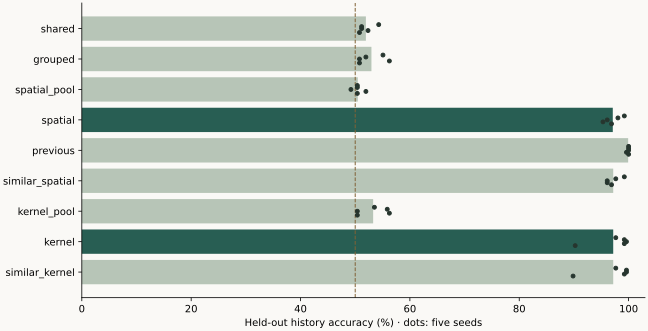
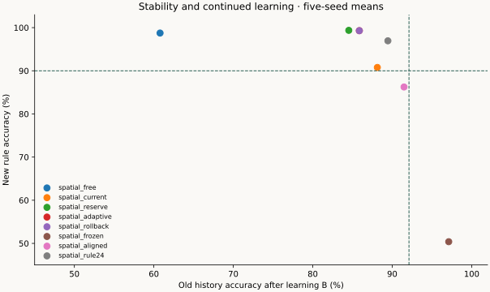

# Go14：历史读出改善，整体在线链条尚未闭合

2026-10-21 · 五个新种子 · 10×10 围棋 · 独立核验后的研究记录

## 本轮结论

**位置化写入与位置查询解决了本轮的历史读出失败。** 相同参数预算下，共享写入的留出准确率为 51.95%，位置查询为 97.11%；同样扩大状态但平均读出的对照为 50.47%。上一观察寄存器对照为 99.92%。这表明任务确实可以学会，也表明增加环状态本身不足以解决问题。位置模型到 1,024 条反馈时仍仅有 51.80%，所以少量反馈高效学习尚未实现。

**尚无方法通过预定联合门槛。** 本轮建立了可学的历史能力，并检验了真实的旧能力保护；仍未完成稳定的‘新判断提升＋旧判断保持’链条。

同时，**在线约束已有可测量的保持收益**：自适应方案的新规则准确率为 99.30%，无保护为 98.75%；旧历史保持分别为 85.86% 与 60.78%。自适应方案接受 320/320 次更新，实际平均步长 0.16859，无保护为 0.17487。这是有新学习时的部分保持收益，尚未达到旧准确率下降不超过五个百分点的目标。

正交位置模型与稳定相似变换模型的历史准确率分别为 97.11% 和 97.19%。当前证据支持可寻址读出的价值，未建立欧氏正交相对该稳定对照的独有任务优势。配对历史只改变 5/640 对原始贪心落子，说明行动转化仍弱。完整对局及未保存行为另列，不用历史题准确率代替棋力。

完整对局中，策略对齐方案为 48/120 胜，冻结参照为 48/120 胜，自适应方案为 43/120 胜；本轮没有建立超出冻结参照的棋力收益。

## 实验边界与公平比较

正式种子固定为 1009、1013、1019、1021、1031，开发种子 4903 排除。每种子先用 24 局完整教师棋谱训练共同空间先验 24 epoch，另有四局独立探针棋谱。随后 A 为 2,048 条劫历史反馈，B 为 1,024 条自杀／可落子反馈；每 16 条反馈更新一次，分别为 128 次与 64 次机会。A→B 保留 Adam 状态。留出 A、B 各 256 条；每条历史两次观察，从规则合法的设置局面构造并平衡两种标签，属于结构化同生成分布测试，并非自然对局中的历史频率。先预测再接收反馈，训练流单次访问。

九种结构均有 36,191 个总参数、32,577 个声明可更新参数，学习张量形状与初始化值逐一相同。不同前向路径激活的参数作用不完全相同：寄存器对照使用既有修正头的另一半输入，位置查询消融移除相应信息通路。因此这是相同参数预算比较，不是所有有效自由度、状态容量或计算成本都相等。位置状态从 96 增至 9,600 个 float32 坐标，单流内存从 384 增至 38,400 字节；寄存器对照为 2,840 字节。

保护训练过且正确的历史锚点：四种可读环模型共同选出 12 对，按查询象限和执色分层；主比较使用前八对／16 条，`rule24` 使用全部 24 条。下界为各自初始正确 margin 的一半。策略锚点来自已见训练棋谱，未保存策略探针来自另外四局，均使用两次观察。

源码与协议在正式训练前固定 SHA-256，开发结果全部单列。v1 因有限步入口与提交检查的 float32 边界不一致而中止；v2 统一数值判据，保持 1e-5 容差并从头重跑。除此实现勘误外，模型、参数、预算、锚点规则及种子未调整。统计以五个训练种子为单位；配对 bootstrap 枚举 3,125 个重采样，只作小样本描述，不能把 1,280 道留出题当作 1,280 次独立训练。

## 一、写入与查询：历史是否真正学会


| 结构 | 历史准确率 | 成对全对率 | 重置历史 | 关闭查询修正 | 状态字节 | 学习门槛 |
| --- | --- | --- | --- | --- | --- | --- |
| 共享写入 `shared` | 51.95% | 4.06% | 50.00% | 51.09% | 384 | 未通过 |
| 分组三块写入 `grouped` | 52.97% | 6.09% | 50.00% | 52.11% | 384 | 未通过 |
| 位置写入／平均读出 `spatial_pool` | 50.47% | 1.25% | 50.00% | 50.31% | 38400 | 未通过 |
| 位置写入／位置查询 `spatial` | 97.11% | 94.22% | 50.00% | 50.00% | 38400 | 通过 |
| 上一可见观察寄存器 `previous` | 99.92% | 99.84% | 50.00% | 50.00% | 2840 | 通过 |
| 位置查询／相似变换 `similar_spatial` | 97.19% | 94.38% | 50.00% | 50.00% | 38400 | 通过 |
| 卷积写入／平均读出 `kernel_pool` | 53.28% | 6.72% | 50.00% | 51.41% | 38400 | 未通过 |
| 卷积写入／位置查询 `kernel` | 97.19% | 94.38% | 50.00% | 50.23% | 38400 | 通过 |
| 卷积查询／相似变换 `similar_kernel` | 97.19% | 94.38% | 50.00% | 50.23% | 38400 | 通过 |



学习门槛预先固定为平均准确率至少 80%、成对全对率至少 60%。每对样本末次编码与查询相同、标签相反，因此仅看当前观察的确定性模型不能超过 50%；单纯重置历史的确得到 50%。交换历史前缀的成绩是原准确率的互补，不当作第二份独立证据。


| 结构 | 32 条反馈 | 128 条 | 512 条 | 1,024 条 | 2,048 条 |
| --- | --- | --- | --- | --- | --- |
| shared | 50.00% | 50.00% | 50.08% | 50.31% | 51.95% |
| grouped | 50.00% | 50.00% | 49.84% | 50.39% | 52.97% |
| spatial_pool | 50.00% | 50.00% | 50.00% | 50.08% | 50.47% |
| spatial | 50.00% | 50.00% | 50.00% | 51.80% | 97.11% |
| previous | 50.08% | 51.56% | 63.98% | 93.28% | 99.92% |
| similar_spatial | 50.00% | 50.00% | 50.00% | 52.19% | 97.19% |
| kernel_pool | 50.00% | 50.00% | 50.00% | 49.92% | 53.28% |
| kernel | 50.00% | 50.00% | 50.08% | 52.34% | 97.19% |
| similar_kernel | 50.00% | 50.00% | 50.23% | 53.20% | 97.19% |

这里的判断是指定位置合法性的二分类，并非整盘最佳落子选择。位置模型在 512 条时为 50%、1,024 条时为 51.80%，到 2,048 条才达到 97.11%；上一观察对照在 1,024 条已达 93.28%。这些曲线表明当前环模型尚未具备所期望的少量反馈效率。A 的最终成绩是在共同棋盘先验之后、额外 2,048 条结构化反馈上获得；不能写成模型从零仅凭几局棋就掌握围棋。

### 只读补充：历史判断是否转化为落子选择

以下诊断在主实验锁定后提出，只读取 A 结束时的现有检查点，不改变训练、门槛或模型选择。用原始策略分数直接取贪心动作，不提供引擎合法掩码。配对比较的两条历史有相同当前编码；重置比较则可能引入与目标历史无关的状态分布变化。


| 布局 | 配对历史改变动作／640 | 重置后改变动作／1280 | 合法时选择查询点／640 | 非法时选择查询点／640 | 查询点概率差／百分点 |
| --- | --- | --- | --- | --- | --- |
| shared | 3 | 111 | 0 | 0 | -0.009 |
| grouped | 3 | 83 | 0 | 0 | -0.021 |
| spatial_pool | 0 | 84 | 0 | 0 | -0.004 |
| spatial | 5 | 388 | 2 | 0 | 0.926 |
| previous | 5 | 143 | 0 | 0 | 0.328 |
| similar_spatial | 9 | 392 | 1 | 0 | 0.945 |
| kernel_pool | 1 | 145 | 0 | 0 | -0.010 |
| kernel | 16 | 153 | 0 | 0 | 0.608 |
| similar_kernel | 13 | 129 | 0 | 0 | 0.576 |

位置模型只有 5/640 对因为真实历史差异改变原始贪心动作；查询点在合法分支只被选中两次。概率差方向改善，并不等于学会最佳落子；本任务只提供合法性标签，也没有证明合法回提在每道题中都是最佳手。重置造成 388/1280 个动作变化不能替代这一更严格的配对证据。‘历史判断已可学’与‘判断已经可靠指导围棋决策’应继续分开。

## 二、学会之后：能否继续更新而不丢失旧判断

以下每行是五种子平均；下降为旧任务 A 后到 B 后的准确率差，负数表示改善。主模型旧历史均值为 97.11%。联合门槛同时要求：旧准确率至少 80%、下降不超过五个百分点；新准确率至少 90%、比 B 前提高至少十个百分点。


| 方法 | 旧 A 前→后 | 旧下降／百分点 | 新 B 前→后 | 联合门槛 |
| --- | --- | --- | --- | --- |
| shared_free | 51.95% → 50.00% | 1.95 | 55.23% → 98.75% | 未通过 |
| grouped_free | 52.97% → 50.39% | 2.58 | 58.98% → 99.14% | 未通过 |
| spatial_pool_free | 50.47% → 50.00% | 0.47 | 57.73% → 99.06% | 未通过 |
| previous_free | 99.92% → 57.03% | 42.89 | 50.63% → 98.52% | 未通过 |
| kernel_pool_free | 53.28% → 50.16% | 3.12 | 55.39% → 98.05% | 未通过 |
| spatial_free | 97.11% → 60.78% | 36.33 | 50.39% → 98.75% | 未通过 |
| spatial_current | 97.11% → 88.13% | 8.98 | 50.39% → 90.78% | 未通过 |
| spatial_reserve | 97.11% → 84.53% | 12.58 | 50.39% → 99.38% | 未通过 |
| spatial_adaptive | 97.11% → 85.86% | 11.25 | 50.39% → 99.30% | 未通过 |
| spatial_rollback | 97.11% → 85.86% | 11.25 | 50.39% → 99.30% | 未通过 |
| spatial_frozen | 97.11% → 97.11% | 0.00 | 50.39% → 50.39% | 未通过 |
| spatial_aligned | 97.11% → 91.48% | 5.63 | 50.39% → 86.25% | 未通过 |
| spatial_rule24 | 97.11% → 89.45% | 7.66 | 50.39% → 96.95% | 未通过 |
| similar_spatial_free | 97.19% → 63.13% | 34.06 | 50.23% → 99.61% | 未通过 |
| similar_spatial_current | 97.19% → 89.53% | 7.66 | 50.23% → 98.98% | 未通过 |
| similar_spatial_adaptive | 97.19% → 86.33% | 10.86 | 50.23% → 99.45% | 未通过 |
| kernel_free | 97.19% → 65.08% | 32.11 | 49.30% → 99.53% | 未通过 |
| kernel_current | 97.19% → 88.05% | 9.14 | 49.30% → 83.44% | 未通过 |
| kernel_adaptive | 97.19% → 89.92% | 7.27 | 49.30% → 87.50% | 未通过 |
| similar_kernel_free | 97.19% → 64.84% | 32.34 | 49.77% → 99.30% | 未通过 |
| similar_kernel_current | 97.19% → 89.77% | 7.42 | 49.77% → 83.20% | 未通过 |
| similar_kernel_adaptive | 97.19% → 90.86% | 6.33 | 49.77% → 88.13% | 未通过 |



`current` 是原真实 margin 检查；`reserve` 保留一半线性余量并对缩短的候选重新投影；`adaptive` 再加曲率估计与步长半径；`rollback` 仅在最终拒绝时恢复 Adam 状态。`aligned` 加策略行为，`rule24` 增加规则锚点。`free` 和 `frozen` 分别显示无保护遗忘与冻结上限。正交与相似变换的同布局控制同时保留。

## 三、有效更新预算与成本

每个非冻结方法累计 5,120 条 B 反馈、320 次尝试。接受只是提交了非零步，不保证有实质学习；表中实际步长是参数空间欧氏范数。耗时为六个训练进程并行时各种子记录的墙钟时间之和，不是专用硬件基准或整个研究总用时。


| 方法 | 接受／尝试 | 激活约束 | 缩步次数 | Adam 回退 | 候选均范数 | 实际均范数 | B 耗时／秒 |
| --- | --- | --- | --- | --- | --- | --- | --- |
| shared_free | 320/320 | 0 | 0 | 0 | 0.20883 | 0.20883 | 14.8 |
| grouped_free | 320/320 | 0 | 0 | 0 | 0.20821 | 0.20821 | 18.7 |
| spatial_pool_free | 320/320 | 0 | 0 | 0 | 0.20026 | 0.20026 | 48.5 |
| previous_free | 320/320 | 0 | 0 | 0 | 0.19841 | 0.19841 | 21.0 |
| kernel_pool_free | 320/320 | 0 | 0 | 0 | 0.22285 | 0.22285 | 61.6 |
| spatial_free | 320/320 | 0 | 0 | 0 | 0.17487 | 0.17487 | 89.6 |
| spatial_current | 264/320 | 253 | 826 | 0 | 0.25579 | 0.12380 | 634.0 |
| spatial_reserve | 306/320 | 264 | 369 | 0 | 0.19530 | 0.17714 | 574.8 |
| spatial_adaptive | 320/320 | 261 | 19 | 0 | 0.19955 | 0.16859 | 519.8 |
| spatial_rollback | 320/320 | 261 | 19 | 0 | 0.19955 | 0.16859 | 544.5 |
| spatial_frozen | 0/0 | 0 | 0 | 0 | 0.00000 | 0.00000 | 53.5 |
| spatial_aligned | 267/320 | 309 | 875 | 0 | 0.31103 | 0.07885 | 1258.2 |
| spatial_rule24 | 320/320 | 279 | 22 | 0 | 0.22617 | 0.14455 | 1219.3 |
| similar_spatial_free | 320/320 | 0 | 0 | 0 | 0.17293 | 0.17293 | 97.3 |
| similar_spatial_current | 294/320 | 239 | 641 | 0 | 0.20869 | 0.14967 | 662.9 |
| similar_spatial_adaptive | 320/320 | 244 | 15 | 0 | 0.19711 | 0.17354 | 549.6 |
| kernel_free | 320/320 | 0 | 0 | 0 | 0.18837 | 0.18837 | 79.1 |
| kernel_current | 167/320 | 317 | 1698 | 0 | 0.30465 | 0.06719 | 490.9 |
| kernel_adaptive | 320/320 | 281 | 44 | 0 | 0.29008 | 0.08337 | 416.0 |
| similar_kernel_free | 320/320 | 0 | 0 | 0 | 0.18931 | 0.18931 | 70.3 |
| similar_kernel_current | 151/320 | 316 | 1741 | 0 | 0.31455 | 0.06448 | 535.3 |
| similar_kernel_adaptive | 320/320 | 280 | 39 | 0 | 0.28074 | 0.08272 | 392.5 |

完整 JSON 另存每窗预测、真实标签、投影次数、投影收敛、最小非零步长与回退记录。规则锚点和法向量的存储远大于单条环状态；以下是实际保存的约束张量字节，不包含 Python 对象、临时自动微分图或进程峰值内存。


| 主方法 | 每种子规则／策略锚点 | 约束张量字节／种子 | 最终锚点违规数 |
| --- | --- | --- | --- |
| spatial_free | 16/0, 16/0, 16/0, 16/0, 16/0 | 0, 0, 0, 0, 0 | 35 |
| spatial_current | 16/0, 16/0, 16/0, 16/0, 16/0 | 2124352, 2124352, 2124352, 2124352, 2124352 | 0 |
| spatial_reserve | 16/0, 16/0, 16/0, 16/0, 16/0 | 2124352, 2124352, 2124352, 2124352, 2124352 | 0 |
| spatial_adaptive | 16/0, 16/0, 16/0, 16/0, 16/0 | 2124352, 2124352, 2124352, 2124352, 2124352 | 0 |
| spatial_rollback | 16/0, 16/0, 16/0, 16/0, 16/0 | 2124352, 2124352, 2124352, 2124352, 2124352 | 0 |
| spatial_frozen | 16/0, 16/0, 16/0, 16/0, 16/0 | 0, 0, 0, 0, 0 | 0 |
| spatial_aligned | 16/8, 16/8, 16/5, 16/8, 16/6 | 3187464, 3187464, 2788797, 3187464, 2921686 | 0 |
| spatial_rule24 | 24/0, 24/0, 24/0, 24/0, 24/0 | 3186528, 3186528, 3186528, 3186528, 3186528 | 0 |

free/frozen 表中的规则锚点数用于事后对照，其学习器没有加载保护约束；因此约束存储为零。未保护的违规不是保护合同失败。

## 四、受保护对象是否与整体行为对齐

`aligned` 的策略锚点数依次为 8、8、5、8、6，没有用不正确或 margin 不足的行为补齐。只有八条齐全的种子，`aligned` 与 `rule24` 的约束方向数才相同。以下 120 个探针来自未保存局面，衡量 A→B 的行为变化；教师一致率不是最优棋判断准确率。


| 方法 | 留出贪心动作改变／120 | 策略 KL（前‖后） | 教师一致率前→后 | 原始停着概率前→后 |
| --- | --- | --- | --- | --- |
| shared_free | 77 | 3.3786 | 26.67% → 21.67% | 0.26% → 3.82% |
| grouped_free | 79 | 3.1230 | 25.83% → 23.33% | 0.22% → 1.77% |
| spatial_pool_free | 82 | 2.2730 | 25.83% → 25.83% | 0.25% → 1.38% |
| previous_free | 78 | 3.2346 | 27.50% → 23.33% | 0.27% → 3.56% |
| kernel_pool_free | 75 | 3.0743 | 25.83% → 23.33% | 0.28% → 3.48% |
| spatial_free | 99 | 4.8091 | 19.17% → 26.67% | 0.21% → 1.80% |
| spatial_current | 79 | 2.8084 | 19.17% → 25.00% | 0.21% → 0.95% |
| spatial_reserve | 96 | 3.7491 | 19.17% → 25.00% | 0.21% → 1.48% |
| spatial_adaptive | 95 | 3.6171 | 19.17% → 25.83% | 0.21% → 1.40% |
| spatial_rollback | 95 | 3.6171 | 19.17% → 25.83% | 0.21% → 1.40% |
| spatial_frozen | 0 | 0.0000 | 19.17% → 19.17% | 0.21% → 0.21% |
| spatial_aligned | 73 | 1.9954 | 19.17% → 26.67% | 0.21% → 0.88% |
| spatial_rule24 | 92 | 3.6344 | 19.17% → 25.00% | 0.21% → 1.32% |
| similar_spatial_free | 97 | 4.4473 | 19.17% → 26.67% | 0.21% → 1.29% |
| similar_spatial_current | 92 | 3.2448 | 19.17% → 26.67% | 0.21% → 0.94% |
| similar_spatial_adaptive | 93 | 3.2662 | 19.17% → 26.67% | 0.21% → 1.15% |
| kernel_free | 88 | 3.3847 | 24.17% → 26.67% | 0.23% → 2.46% |
| kernel_current | 57 | 0.7532 | 24.17% → 24.17% | 0.23% → 1.20% |
| kernel_adaptive | 60 | 0.9943 | 24.17% → 28.33% | 0.23% → 1.13% |
| similar_kernel_free | 87 | 3.4385 | 23.33% → 26.67% | 0.23% → 2.48% |
| similar_kernel_current | 55 | 0.6807 | 23.33% → 25.00% | 0.23% → 1.09% |
| similar_kernel_adaptive | 63 | 1.2820 | 23.33% → 28.33% | 0.23% → 1.31% |

策略保护从 A 结束后开始，不能据此宣称 A 学习期间的原始先验策略也已得到保持。保存行为达标与未保存行为泛化是两种证据。保护的是选定上下文中的输出 margin，不是一个‘永久不遗忘’标签；被冻结的策略头仍会因共享特征变化而改变选择。

动作变化本身还可能纠正旧错误。下面对同一批已保存预测作事后重评分，区分原有教师一致行为的保持与新增加的一致行为；不增加训练或挑选局面。教师一致仍只是代理指标，不能等同于最优落子。


| 方法 | 原有教师一致动作 | 其中保持 | 其中丢失 | 新增加的一致动作 |
| --- | --- | --- | --- | --- |
| spatial_free | 23 | 7 | 16 | 25 |
| spatial_current | 23 | 11 | 12 | 19 |
| spatial_reserve | 23 | 7 | 16 | 23 |
| spatial_adaptive | 23 | 7 | 16 | 24 |
| spatial_rollback | 23 | 7 | 16 | 24 |
| spatial_frozen | 23 | 23 | 0 | 0 |
| spatial_aligned | 23 | 14 | 9 | 18 |
| spatial_rule24 | 23 | 9 | 14 | 21 |

自适应规则保护只保留原有 23 个教师一致动作中的七个，加入策略锚点后保留十四个。这是保护对象对齐的局部迹象；与此同时新规则准确率由 99.30% 降到 86.25%，没有形成联合成功。五种子共 23 个原有一致动作的样本量很小，且不能把所有其他动作漂移都计作遗忘。

## 五、完整 10×10 对局检查

六个预定方法各 120 局，共 720 局冻结评估；加新共同先验与探针的 140 局，本轮正式记录总计 860 局。双方必须连续两次停着终局，没有达到步数上限后直接判胜。配对换色、4／24／60 手开局、两类启发式对手；16 次搜索模拟、深度八、值头贡献为零。其他学习控制没有运行完整比赛，不对它们报告胜率。


| 方法 | 胜局／120 | 胜率 | 平均目差 | 原始贪心合法率 | 对局耗时／秒 |
| --- | --- | --- | --- | --- | --- |
| shared_free | 42/120 | 35.00% | -41.44 | 93.80% | 534.0 |
| spatial_free | 26/120 | 21.67% | -63.42 | 96.76% | 787.5 |
| spatial_current | 44/120 | 36.67% | -47.03 | 90.19% | 761.9 |
| spatial_adaptive | 43/120 | 35.83% | -47.09 | 94.23% | 708.4 |
| spatial_aligned | 48/120 | 40.00% | -51.58 | 92.79% | 747.8 |
| spatial_frozen | 48/120 | 40.00% | -31.06 | 65.92% | 594.8 |

搜索使用引擎合法动作约束及真实终局规则；其最终落子合法不能反过来证明网络原始判断可靠。这里的比赛检验模型与搜索的集成表现，没有在对局中更新参数。结构化劫任务的提升不能直接外推成自然长历史、一般超级劫能力或完整在线棋力学习。

从任务定义可以解释两者为何未必同步：A、B 只监督指定位置的合法性，搜索已经通过引擎排除了非法动作；合法动作之间的价值排序没有在这轮得到真实新收益监督。策略头冻结也不能阻止共享特征漂移。这是训练目标与行动效果之间尚未补齐的环节。

完整对局的环状态贯穿所有落子，A/B 训练却只有两次观察，因此评估还包含训练未覆盖的长期状态分布。低胜率同时混合了目标与动作排序不对齐、上下文分布变化和共同先验能力有限，不能单独归因为正交传播失效。后续应先让真实对局的训练和评估上下文一致，再逐步扩长；本轮未做这个额外对照。

## 六、每个种子与配对差异


| 布局／种子顺序 | 1009 | 1013 | 1019 | 1021 | 1031 |
| --- | --- | --- | --- | --- | --- |
| shared | 54.30% | 51.17% | 51.17% | 52.34% | 50.78% |
| grouped | 55.08% | 51.95% | 50.78% | 56.25% | 50.78% |
| spatial_pool | 50.39% | 50.39% | 49.22% | 51.95% | 50.39% |
| spatial | 99.22% | 98.05% | 96.09% | 95.31% | 96.88% |
| previous | 100.00% | 100.00% | 100.00% | 99.61% | 100.00% |
| similar_spatial | 99.22% | 97.66% | 96.09% | 96.09% | 96.88% |
| kernel_pool | 53.52% | 55.86% | 50.39% | 56.25% | 50.39% |
| kernel | 97.66% | 99.22% | 99.61% | 99.22% | 90.23% |
| similar_kernel | 97.66% | 99.61% | 99.61% | 99.22% | 89.84% |


| 主方法 | 各种子旧 A 后 | 各种子新 B 后 |
| --- | --- | --- |
| spatial_free | 60.55%, 69.92%, 51.95%, 55.47%, 66.02% | 100.00%, 99.22%, 99.61%, 94.92%, 100.00% |
| spatial_current | 89.06%, 89.45%, 77.34%, 84.77%, 100.00% | 99.61%, 99.22%, 98.05%, 100.00%, 57.03% |
| spatial_reserve | 87.89%, 88.67%, 73.05%, 83.98%, 89.06% | 99.61%, 99.22%, 98.83%, 100.00%, 99.22% |
| spatial_adaptive | 90.63%, 88.67%, 76.95%, 83.98%, 89.06% | 99.22%, 99.22%, 98.83%, 100.00%, 99.22% |
| spatial_rollback | 90.63%, 88.67%, 76.95%, 83.98%, 89.06% | 99.22%, 99.22%, 98.83%, 100.00%, 99.22% |
| spatial_frozen | 99.22%, 98.05%, 96.09%, 95.31%, 96.88% | 50.00%, 51.17%, 50.00%, 50.78%, 50.00% |
| spatial_aligned | 98.83%, 99.61%, 83.59%, 88.28%, 87.11% | 62.50%, 79.69%, 93.36%, 96.48%, 99.22% |
| spatial_rule24 | 96.48%, 88.67%, 82.42%, 84.38%, 95.31% | 92.58%, 99.22%, 98.83%, 100.00%, 94.14% |


| 左组减右组 | 旧 A 差／百分点 [描述性 95% 区间] | 新 B 差／百分点 [描述性 95% 区间] |
| --- | --- | --- |
| spatial_free_minus_shared_free | 10.78 [5.08, 16.48] | 0.00 [-1.17, 0.70] |
| spatial_current_minus_spatial_free | 27.34 [23.05, 31.17] | -7.97 [-25.94, 2.66] |
| spatial_adaptive_minus_spatial_free | 25.08 [21.56, 28.44] | 0.55 [-0.78, 2.89] |
| spatial_adaptive_minus_spatial_current | -2.27 [-6.80, 0.62] | 8.52 [-0.16, 25.39] |
| spatial_rollback_minus_spatial_adaptive | 0.00 [0.00, 0.00] | 0.00 [0.00, 0.00] |
| spatial_aligned_minus_spatial_adaptive | 5.62 [1.48, 9.06] | -13.05 [-26.41, -2.50] |
| spatial_aligned_minus_spatial_rule24 | 2.03 [-3.91, 7.27] | -10.70 [-22.66, -0.47] |
| spatial_current_minus_similar_spatial_current | -1.41 [-5.55, 3.28] | -8.20 [-25.00, 0.31] |
| spatial_adaptive_minus_similar_spatial_adaptive | -0.47 [-3.52, 2.11] | -0.16 [-0.47, 0.00] |
| kernel_current_minus_similar_kernel_current | -1.72 [-2.81, -0.62] | 0.23 [-1.33, 1.41] |
| kernel_adaptive_minus_similar_kernel_adaptive | -0.94 [-2.42, 0.55] | -0.62 [-2.58, 0.86] |

## 数学说明：哪些量被传播，哪些性质需要实验

本节从实际实现推导，所有结论都注明条件。符号中的“环”指一个时间尺度上的带符号状态与正交旋转；六个时间尺度并不等于自动获得六份可辨别的历史。本文也不把欧氏空间旋转称作量子计算。

### 1. 状态、可见观察与参数

棋盘有 $P=100$ 个位置。可见编码 $x_t\in\mathbb R^{306}$ 包含三个棋盘平面及六个元数据；写入先转成固定黑白坐标。标签、合法集合及引擎的超级劫记录均不进入历史任务的前向输入。$j=1,\ldots,6$ 表示时间尺度，$p$ 表示位置，$h^j_{t,p}\in\mathbb R^{16}$ 表示局部状态，$\theta$ 表示当前所有可更新参数。

点式位置模型的递推是

$$h^j_{t,p}=\rho_j R^j_\theta(x_t)h^j_{t-1,p}+\gamma_j U^j_\theta u_{t,p},\qquad (R^j_\theta)^\top R^j_\theta=I.$$

这里 $\rho=(0,.5,.85,.93,.97,.99)$，$\gamma_j=\sqrt{1-\rho_j^2}$。本轮写入门恒为一，状态激活为恒等，写入激活是 $\tanh$。$U^j$ 是 $8\to16$ 的写入映射，不要求它正交。正交性约束的是状态传播 $R$，并不使所有网络层都成为等距映射。

全部位置展平后，状态雅可比为

$$A^j_t=\frac{\partial h^j_t}{\partial h^j_{t-1}}=\rho_j(I_P\otimes R^j_\theta(x_t)).$$

这是在输入序列和当前参数固定时的状态导数。旋转依赖输入及参数，所以求参数导数时不能把它当常数。源码的局部自动微分项仍包含旋转参数导数。

### 2. 三种写入为什么产生不同的可读性

原共享写入把整盘压入一个八维向量，各环再从这个向量获得写入：

$$u_t=\tanh(Wx_t),\qquad h^j_t=\rho_jR^j(x_t)h^j_{t-1}+\gamma_jU^ju_t.$$

比较两条两次观察历史，假设末次观察 $x_2$ 完全相同、初态都为零。首观察差异经过两步后满足

$$\Delta h_2=\begin{bmatrix}\rho_1\gamma_1R^1(x_2)U^1\\\vdots\\\rho_6\gamma_6R^6(x_2)U^6\end{bmatrix}\Delta u_1=M(x_2)\Delta u_1,\qquad \operatorname{rank}M\le8.$$

这说明该条件下，增加共享写入的环数没有增加首观察差异所能占据的线性子空间维数。它不证明八维一定学不会任务，也不构成任意长历史的统一容量定理。不同时间的输入条件化旋转可以改变子空间方向；当前证据针对的是具体两次观察任务。

点式写入重新解释同一张 $8\times306$ 权重，不增加学习张量：

$$u_{t,p,k}=\tanh\left(\sum_{c=1}^{3}W_{k,c,p}X_{t,c,p}+\sum_{q=1}^{6}V_{k,q}m_{t,q}\right).$$

首观察不再被强制合并成同一个八维向量，而是写入 $P$ 个可寻址位置。写入向量有 $8P$ 个坐标，但不能据此称有 $8P$ 个独立输入自由度：其局部雅可比秩仍不超过 $\min(8P,3P+6)$，真实围棋观察的约束还会进一步限制可达集合。

卷积写入则把同一 $8\times300$ 部分解释成 $8$ 个 $3\times10\times10$ 核：

$$u_{t,p,k}=\tanh\left(\sum_{c,a,b}K_{k,c,a,b}X_{t,c,p+(a,b)}+V_km_t\right).$$

边界采用零填充。共享相对坐标系数可以改变归纳偏置，但输入条件化旋转及其他读出仍含全局信息，不能宣称整个网络严格平移等变，也不能从卷积形式推出旧能力必然泛化保持。

### 3. 保留差异不等于读出差异

设读出为 $z=\psi_\theta(h,x,p)$，其局部状态导数为 $C=\partial\psi/\partial h$。一阶差异是

$$\Delta z\approx C\Delta h.$$

即使 $\|\Delta h\|$ 完全不衰减，只要 $\Delta h\in\ker C$，任务输出仍不可区分。更一般地，若一组查询的局部读出矩阵为 $C_q$，可用

$$\mathcal O=\sum_q C_q^\top C_q,\qquad \sum_q\|C_q\Delta h\|^2=\Delta h^\top\mathcal O\Delta h$$

描述该组查询对状态差异的局部可观察性。这个矩阵只是推导中的诊断对象，本轮没有声称已测得全局可观察性谱。训练后的准确率、成对全对率及历史干预才是本轮实际任务证据。

位置平均算子是 $\bar h=P^{-1}\sum_p h_p$。一切满足 $\sum_p\Delta h_p=0$ 的位置差异都在它的核里。因而 `spatial_pool` 与 `spatial` 的比较特别关键：它们有相同写入、相同状态数和相同参数预算，差别是是否在查询位置访问内容。这个比较比单独宣称“状态变大后成绩变好”更能定位读出瓶颈。

在本轮相同末次观察的条件下，还可以得到更直接的结论。各位置共享同一个 $R^j(x_2)$ 与 $U^j$，因此求和与这些线性映射交换，得到

$$\Delta\bar h_2=M(x_2)\left(\frac1P\sum_p\Delta u_{1,p}\right).$$

也就是说，平均后的条件历史差异再次经过一个至多八维的瓶颈，即使平均前实际保存了 9,600 个状态坐标。这是当前两步、共享空间旋转与写入上投影条件下的精确表达；它不声称八维永远无法编码有限任务。需要与正式训练中平均读出失效的实测一起理解。

实际位置查询保留原有有符号寻址形式。令 $s$ 索引该位置的六环、十六通道，$q_p,k_s$ 为归一化查询及键：

$$\alpha_{p,s}=\tanh(q_p^\top k_s),\qquad r_p=\frac1{\sqrt{96}}\sum_{s=1}^{96}\alpha_{p,s}\,v(h_{p,s},h_{p,s-1},h_{p,s-2},h_{p,s-3}).$$

通道位移在各环内循环；$v$ 是既有的四维到八维线性值映射。$r_p$ 进入原位置修正头。此处没有 softmax 概率解释，也不保证训练一定找到有效键值分工。

### 4. 正交的准确保证与稳定非正交对照

在相同后续输入下，两条状态差异经过 $k$ 次传播有

$$\Delta h^j_{t+k}=\rho_j^k Q\Delta h^j_t,\qquad Q^\top Q=I,\qquad\|\Delta h^j_{t+k}\|_2=\rho_j^k\|\Delta h^j_t\|_2.$$

所以正交部分不额外改变长度；泄漏仍在衰减。$\rho=.99$ 的 64 步长度比例约为 $0.5256$。该等式没有涉及读出、反馈或分类，不能当作“64 步历史任务已经学会”。

稳定相似变换对照使用 $\widetilde R_t=SR_tS^{-1}$，固定对角矩阵 $S$ 的条件数为二。连乘时中间坐标变换相消：

$$\widetilde R_T\cdots\widetilde R_1=S(R_T\cdots R_1)S^{-1},\qquad\|\widetilde R_T\cdots\widetilde R_1\|_2\le2.$$

在度量 $M=S^{-\top}S^{-1}$ 下，它满足 $\widetilde R_t^\top M\widetilde R_t=M$。这个对照避免把“没有额外指数遗忘”仅留给正交组。它不是任意非正交网络的代表；若成绩接近，只能说当前任务未显示欧氏正交相对于这一稳定对照的额外收益。

### 5. 跨时间传播的是行为约束的导数

一个保存行为的正确 margin 写为 $m(\theta)=\phi_\theta(h_T,x_T)$。终端状态协向量是 $\lambda_T=\partial\phi/\partial h_T$。链式法则给出

$$\lambda_{t-1}=A_t^\top\lambda_t.$$

它把“末端行为对状态扰动的敏感方向”传回更早位置；并没有复制或传播一层的权重值。若 $h_t=F_\theta(h_{t-1},x_t)$，记固定 $h_{t-1}$ 时的局部参数雅可比为 $G_t=\partial F_\theta/\partial\theta$，完整参数梯度是

$$\nabla_\theta m=\left.\partial_\theta\phi_\theta\right|_{h_T}+\sum_{t=1}^{T}G_t^\top\lambda_t.$$

第一项是读出对参数的直接依赖；求和项包含每次写入与输入条件化旋转的依赖。漏掉任何一项，就不是当前模型行为的完整约束。实现每个反馈窗口按当前参数重算这些法向量，并与完整自动微分进行数值对拍。这里的“实时”是每 16 条反馈一次重算，不是每一墙钟时刻连续求解。

推导还要求这段保存历史在同一当前参数下重算。若一个持续在线状态实际由历次不同参数 $\theta_1,\theta_2,\ldots$ 累积，它不一定等于从零用当前参数重新运行历史得到的状态。本轮独立两次观察和冻结对局满足所述条件；进入真正长在线闭环时，需要沿状态版本与重放协议另外核验，不能直接套用本节结论。

对单步正交变换 $h'=Qh$，若列矩阵 $N$ 收集状态空间的约束法向量，投影到其正交补的算子满足

$$P_N=I-N(N^\top N)^\dagger N^\top,\qquad P_{QN}Q=QP_N.$$

证明：$(QN)^\top(QN)=N^\top N$，代入左式即可。这解释了正交坐标变化为什么不会扭曲欧氏约束投影。但本项目实际更新是在参数空间做半空间投影，而 $G_t$、多个时间项与 Adam 预条件并非正交。不能从这条状态空间恒等式推出所有参数更新天然等价、全局最优或永不遗忘。

与 ResNet 的相似之处在于保留一条可控的传播路径；差别在于这里关注的是行为敏感方向及其几何，而不是通过恒等捷径保证任意跨层更新都可安全提交。

本轮实际使用的是行为 margin 半空间投影：允许旧行为在下界内变化或改善。它不是把更新完全投到旧梯度正交补的等式型 OGD；上面的正交补恒等式解释几何协调性，不能替代下面的不等式优化问题。

数值稳定也不自动带来低延迟。保存 $K$ 个法向量需要 $K\times32577$ 个浮点数，$K=24$ 时仅这部分就是 3,127,392 字节。当前通用伴随后端显式存储目标数 $K$ × 批大小 $B$ × 状态宽度 $H$ 的协向量；当 $K=B=24,H=9600$ 时为 22,118,400 字节，尚不包含其他临时张量。各锚点其实按批独立，未来可以利用这种稀疏性减少重复计算；本轮没有实施或测得这一加速，耗时仍按实际程序报告。

### 6. 有限步为什么需要内部余量

保存行为 $i$ 的下界是 $b_i>0$；当前余量为 $c_i=m_i(\theta)-b_i\ge0$，法向量 $a_i=\nabla m_i(\theta)$。先由一次新反馈得到 Adam 参数候选 $d$，范数截到 $0.5$。原方法求

$$\delta_0=\underset{\delta}{\operatorname{argmin}}\;\frac12\|\delta-d\|_2^2\quad\text{使}\quad a_i^\top\delta\ge-c_i.$$

这只保留线性化余量。设 $m_i$ 在整条线段上可微且梯度具有已知 Lipschitz 常数 $L_i$，由积分形式的泰勒余项得到

$$m_i(\theta+\delta)\ge m_i(\theta)+a_i^\top\delta-\frac{L_i}{2}\|\delta\|_2^2.$$

推导：将梯度差沿 $s\delta$ 积分，误差绝对值不超过 $\int_0^1L_is\|\delta\|^2ds$。若线性约束刚好落在边界，二阶负余项即可使实际更新违规。这解释了“投影求解成功”与“真实更新被拒绝”可以同时出现。

新方法保留一半当前余量，即 $\eta=1/2$：

$$a_i^\top\delta\ge-(1-\eta)c_i\quad\Longrightarrow\quad m_i(\theta+\delta)-b_i\ge\eta c_i-\frac{L_i}{2}\|\delta\|^2.$$

若 $L\ge\max_i L_i$ 是真实上界，且

$$\|\delta\|\le\sqrt{\frac{2\eta\min_i c_i}{L}},$$

就得到所有这些光滑 margin 的有限步充分条件。若最小余量为零，该条件可能只允许零步，这不是一个保证持续学习的定理。

实际浮点容差内，$c_i$ 还可能略小于零；代码在构造线性边界时将这部分余量截为零。此时不满足上述实数定理的 $c_i\ge0$ 前提，非零候选仍须由明确的实际 margin 检查裁决。

本轮没有获得真实全局 $L$。代码从试探步观察

$$\widehat L=\frac{2\max_i[m_i(\theta)+a_i^\top\delta-m_i(\theta+\delta)]_+}{\|\delta\|^2}$$

并维护衰减最大值、缩小信赖半径。它是搜索启发式，不能替代上式中的真实曲率上界。每个候选仍要重新计算真实 margin；未通过就拒绝，最多九次试探。`reserve` 缩短原 Adam 候选后重新投影；原 `current` 则缩短已投影的步，两个操作一般不等价。

### 7. 策略 margin 的非光滑细节

保存策略动作 $a^*$ 和该局面的合法集合 $\mathcal A$，使用

$$m_{\mathrm{pol}}(\theta)=z_{a^*}(\theta)-\max_{a\in\mathcal A\setminus\{a^*\}}z_a(\theta).$$

当这个 margin 为正，所选动作优于所有保存的合法竞争动作。每个窗口重新选择最强竞争动作，并传播该分支的梯度；候选提交前再对全部合法竞争动作取最大值。

竞争动作发生切换时，$m_{\mathrm{pol}}$ 可能不可微。上一节的光滑曲率定理不能直接套用到该最大值表达式上，除非额外证明活跃分支保持不变，或对每个成对光滑 margin 分别建立界。当前实现依赖实际有限步检查保持保存动作，不宣称曲率估计已证明整个非光滑可行域。

### 8. 拒绝参数步之后，优化器是否也应回退

Adam 的动量更新可以简写为

$$v_t=\beta_1v_{t-1}+(1-\beta_1)g_t,\qquad s_t=\beta_2s_{t-1}+(1-\beta_2)g_t^2.$$

一次参数候选被拒绝，不代表这些内部状态没有改变。默认策略保留已经看到的梯度，下一次候选会受它影响；`rollback` 则在所有试探都失败时恢复本次之前的动量及步数。两者都没有访问未来标签，但语义不同。单独比较接受数不够，还必须看最终新能力、旧能力、实际步长与成本。若没有发生拒绝，两种策略没有受到区分它们所需的考验。

### 9. 有限锚点为什么不能证明总体保持

令 $\mathcal S$ 为保存锚点，$\mathcal D$ 为目标局面分布。当前真实检查最多给出

$$\forall x_i\in\mathcal S,\quad m(\theta_{t+1};x_i)\ge b_i-10^{-5}.$$

代码按 float32 计算的 $b_i-10^{-5}$ 比较阈值执行这个合同；它没有给出实数网络输出的严格舍入误差界。v2 勘误统一了入口与提交的计算顺序，避免同一个边界值被一处接受、另一处误报。因而“零违规”应理解为该明确数值判据下的零违规。

它没有直接给出 $\Pr_{x\sim\mathcal D}[m(\theta_{t+1};x)>0]$ 的下界。一个可构造的反例是：参数含锚点完全不敏感的方向 $v$，即所有 $a_i^\top v=0$，但某个未保存局面的梯度与 $v$ 不正交。沿该方向更新，可以保持全部锚点的一阶行为，同时改变该局面的判断；若模型在锚点上完全不依赖该参数，甚至可保持锚点的精确行为。

若进一步知道 $m$ 对输入的 Lipschitz 常数 $K$，保存样本构成目标支持的 $\varepsilon$ 网，并且每个保存 margin 至少为 $b>K\varepsilon$，才有一种覆盖型充分条件：

$$m(\theta;x)\ge m(\theta;x_i)-K\|x-x_i\|\ge b-K\varepsilon>0.$$

本轮没有证明这样的覆盖半径或统一常数。因此按查询区域与执色分层只是改善采样覆盖的工程措施，不能替代未保存局面上的实测。

策略头被冻结也不等于策略被冻结。若 $z=W\phi_\theta(x)$ 且 $W$ 固定，仍有 $\Delta z=W\Delta\phi$。本轮策略锚点尝试保护真正的输出选择；它只覆盖保存的两次观察上下文，完整对局中的更长状态仍是分布外推问题。

### 10. 如何判定整条算法链成立

必须先有可读历史带来的留出判断，再检验收到新反馈后的学习与保持：

$$\text{写入}\longrightarrow\text{可读历史}\longrightarrow\text{正确新判断}\longrightarrow\text{受控的继续更新}.$$

本轮旧任务门槛是准确率至少 $80\%$ 且成对全对率至少 $60\%$；联合门槛还要求旧任务下降不超过五个百分点、新任务准确率至少 $90\%$ 且提高至少十个百分点。门槛是预先固定的操作性标准，不是理论上的充分必要条件。

每 16 条独立历史反馈的一次更新属于分块在线学习。它不等于模型在自然完整对局中自主发现错误、产生新任务并验证自身修改。本轮完整对局冻结参数，检验集成后的行为；不能用它们宣称已建立完整在线对局学习或 RSI。下一阶段应在联合门槛和分布保持证据基础上设计真实长历史与自主验证，而非仅增加环数。

## 下一轮应验证什么

优先保留本轮已验证的位置查询，让新实验从真正学会的历史能力出发。然后在固定的 32／128／512 条预算上检验写入尺度、读出归一化和初始化；正交传播继续保留，不能把这些未实施的尝试写成已有少样本优势。与此同时保留更省状态内存的上一观察对照：它在 A 上更准，却在无保护继续学习后明显遗忘，说明保存信息与保持读出是两个问题。本轮没有给这个寄存器对照施加同等行为保护，因此尚不能排除‘简单外部记忆＋相同行为约束’更有竞争力。

下一轮先加入相同参数预算的交错 A/B 或联合训练参照，区分模型能否同时表示两类规则与顺序更新路径的问题；反馈量、重用旧样本次数与成本分别报告。再在训练样本池中选择覆盖不同位置、任务行为和梯度方向的约束，保留独立留出集。不能把本轮退化全部归因于锚点数量，也不能凭增加锚点就宣布分布保持已解决。

有限步方面应同时优化保持、学习与延迟。内部余量和自适应步长减少了冻结，但没有自动改善留出保持；优化器回退没有受到真正拒绝事件的充分考验。利用批独立性降低法向量计算成本可以保留当前数学合同，需另做等价性与实测耗时检查。

判断到行动的下一项任务，应让两个同样可行的选择具有可验证的不同收益，并检查历史是否改变正确选择；规则学习则同时报告不依赖引擎掩码的原始判断和非法尝试。围棋真实终局、策略排序反馈与旧行为保持要接入同一个在线闭环，避免只训练辅助分类器。

在上述链条达到预定标准后，再依次扩大真实历史长度并控制反馈次数与更新频率，检查状态版本一致性。完整 RSI 还需要提出候选改进、分配测试预算、使用独立验证并决定保留或回退；本轮固定任务与固定边界的更新系统尚未具备这一能力。以上是后续可检验方案，均未写成本轮结果。

## 证据、复现与开发记录

独立核验重建了五种子全部原始历史、训练／留出隔离和真实规则标签，检查 860 局完整棋谱的合法步、两次停着、目数及胜负；复算 110 个后续学习配置的第一窗更新和检查点最终输出。另从检查点复现 6 局完整学生搜索轨迹，并在其余种子抽查第一步，总计 381 次搜索决策。检查点 SHA 保存在审计 JSON 中；检查点不提交 Git。

22 条验证命令全部通过：199 项根目录测试、数学恒等式检查、离线 Digits 回归、快速示例与语法编译。策略概率复算使用 float32 容差（绝对 1e-7、相对 1e-6），动作必须完全一致；曲率估计含 float32 差分除以步长平方，复算采用绝对 1e-5、相对 1e-4 容差；接受／拒绝与计数必须完全一致。初版逐位比较和过严曲率诊断容差触发的核验失败记录保留在执行日志中，不影响或改写正式实验。

开发种子 4903 的结果没有混入正式平均。弱先验为两局／两 epoch；正式先验设计为 24 局／24 epoch。强先验开发中，共享写入约 50.39%、位置查询约 96.09%、上一观察对照 100%；位置模型配少量高 margin 锚点后旧任务约 72%–73%，卷积共享约 55%–57%。这些失败促成正式协议中的分层共同锚点及完整对照，但不能据开发与正式结果的差异单独推断分层因果效果，二者种子与选择规则不同。

[固定实验协议](go14_plan.md) · [汇总与每种子数值](results/go14_summary.json) · [源码锁定](results/go14_source.json) · [数值勘误](go14_numerical_amendment.patch) · [v1 中止证据](results/go14_v1_interrupted/go14_execution.json) · [验证命令与输出](results/go14_checks.json) · [运行记录](results/go14_execution.json) · [独立核验记录](results/go14_audit_execution.json) · [核验容差说明](results/go14_numerical_audit_notes.json) · [只读动作诊断](results/go14_action_probe.json) · [旧正确行为重评分](results/go14_policy_quality.json) · [Go13 原报告](go13_report.html)

```bash
python3 test_go_readable.py
python3 analysis/go14_run.py --workers 6
python3 analysis/go14_verify.py --stage seeds
python3 analysis/go14_verify.py --stage learning
python3 analysis/go14_verify.py --stage games
python3 analysis/go14_verify.py --stage summary
python3 analysis/go14_action_probe.py
python3 analysis/go14_policy_drift.py
python3 scripts/build_go14_report.py
```

已有同源完整检查点会跳过训练；源码或协议指纹不一致会拒绝混用。无检查点时从固定种子重新生成先验、任务与完整对局。在线实现是独立研究 API；既有默认模型与 Go13 冻结证据保持不变。
